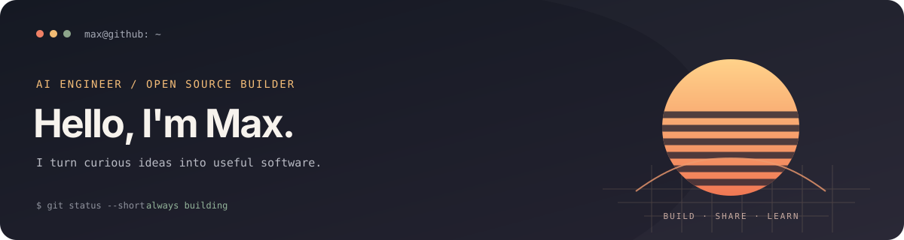

<!-- Generated from live GitHub profile data by tools/generate_hero.py. -->

 

AI Engineer &#8226; Open Source Builder &#8226; Full Stack Dev

  

<!--
**maxzhang666/maxzhang666** is a ✨ _special_ ✨ repository because its `README.md` (this file) appears on your GitHub profile.

Here are some ideas to get you started:

- 🔭 I’m currently working on ...
- 🌱 I’m currently learning ...
- 👯 I’m looking to collaborate on ...
- 🤔 I’m looking for help with ...
- 💬 Ask me about ...
- 📫 How to reach me: ...
- 😄 Pronouns: ...
- ⚡ Fun fact: ...
-->

